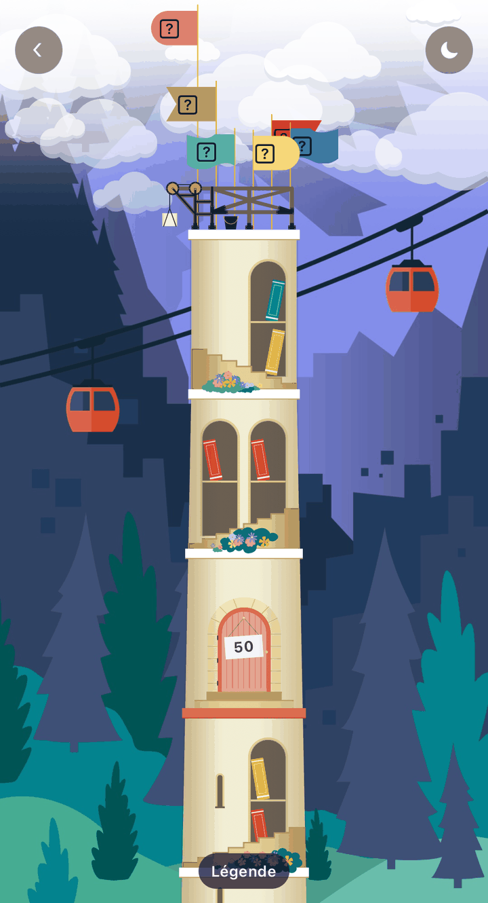
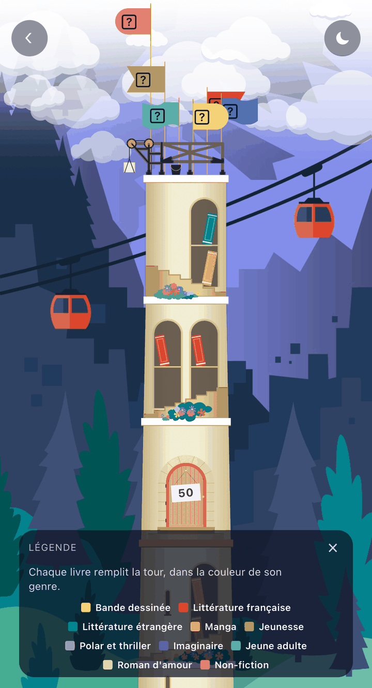
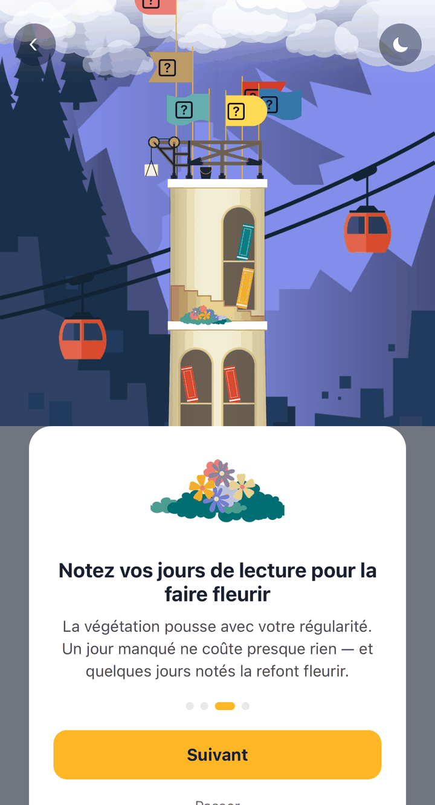

## Nouveautés

### Votre année de lecture devient une tour

La Tour de Babel vous attend dans **Défis › Ma tour de Babel**. Chaque livre
terminé cette année pose un volume sur ses étagères, et la tour gagne des
étages : des paliers s'ouvrent à 10, 20, 50, 100, 200 et 500 livres, chacun
dans son paysage — Prairie, Forêt, Collines, Montagnes, Ciel, Espace.

Elle est en chantier tant qu'elle monte : un échafaudage couronne le sommet,
des grues travaillent sur les étages encore vides. Une règle graduée sur le
côté montre où vous en êtes et ce qui vient ensuite.

### Les couleurs de vos livres sont celles de vos genres

Chaque tranche prend la couleur de son genre littéraire : votre tour dessine
ce que vous aimez lire. La légende se déplie au pied de la tour.

Vos défis en cours plantent leur drapeau au sommet, chacun à la couleur de sa
famille, et le mât monte à mesure que vous avancez dedans.

### Notez vos jours de lecture, la tour fleurit

La végétation suit votre régularité, pas votre performance. Des buissons
poussent sur les corniches et se couvrent de fleurs quand vous lisez souvent.
Un jour manqué ne coûte presque rien, et quelques jours notés suffisent à la
refaire fleurir.

### Les liens Babelio s'ouvrent dans l'application

Un lien vers un profil, une bibliothèque ou une confirmation de compte ouvre
désormais l'écran concerné plutôt que la page d'accueil. Les notifications
font de même.

## Corrections

- **Un livre terminé garde les pages de sa dernière séance.** Si vous étiez
  page 200 sur 300 et que vous lisiez les cent dernières avant d'appuyer sur
  « j'ai terminé », ces pages n'étaient comptées nulle part dans votre
  journal.
- **Plus de relecture apparue toute seule**, ni de ligne à « 0 % » le jour où
  vous ouvriez une lecture — elle devenait la plus récente et les cartes
  d'accueil vous annonçaient 0 % sur un livre lu à moitié.
- **Les deux dates de lecture s'éditent** à la fin d'un livre, et plus
  seulement celle de fin.
- **Le chronomètre fonctionne depuis une fiche de livre.** Une séance lancée
  de là répondait « Erreur. » à chaque enregistrement.
- **Plus d'épingle apparue d'office** en passant un livre à « À lire » ou
  « Lu », et détacher un livre ne le retire plus de « Possédés »,
  « Empruntés » ou « À échanger ». Scanner un livre déjà dans votre
  bibliothèque ne vide plus ses étagères non plus.
- **L'épingle est visible** en mode sombre et en mode Cozy ; elle y était
  noire sur fond sombre.
- **Plus de bandes blanches** en haut et en bas de l'écran en mode sombre,
  Cozy et Papier Crème.
- **Les messages de confirmation sont lisibles** dans les quatre modes : en
  Papier Crème le texte avait la couleur exacte de son fond.
- **La recherche de livres fonctionne de nouveau.** Son index était tombé et
  répondait zéro résultat à n'importe quel titre.
- **Les dates restent en français.** Traverser certains écrans suffisait à
  faire basculer « Lu du 18 août » en « 18 August » pour le reste de la
  session.
