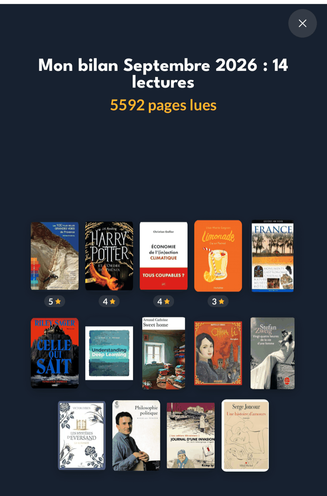
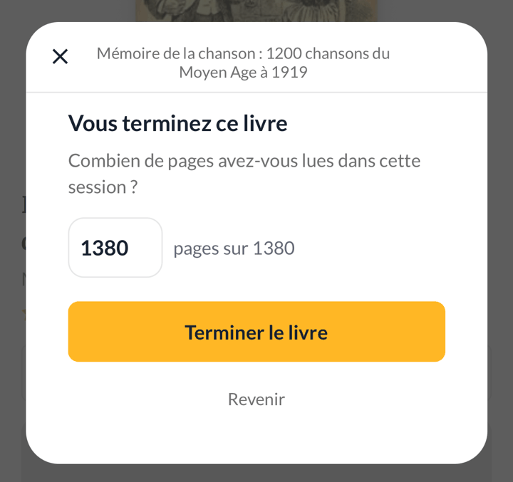

## Nouveautés

### Votre bilan du mois les montre tous

Le bilan mensuel n'affichait que neuf couvertures, tirées au sort parmi
vos lectures, sous un titre qui annonçait pourtant le vrai total. Il les
montre maintenant toutes : jusqu'à trente par page, et une deuxième page
au-delà. Il n'y a plus rien à mélanger, donc plus de bouton pour le faire.

### Les pages qui restaient comptent pour une séance

Terminer un livre depuis vos avancées est souvent la plus longue séance de
toutes. L'application vous propose désormais les pages qui vous restaient à
lire, et vous laisse corriger ce nombre avant de l'enregistrer : si vous
aviez lu une partie ailleurs sans la noter, vous n'êtes plus crédité de
pages que vous n'avez pas lues ce jour-là.

### Vos avancées en pourcentage comptent aussi en pages

Noter « j'en suis à 60 % » alimente maintenant votre journal en pages, au
même titre qu'une page saisie à la main. Votre nombre de pages lues du mois
ne dépend plus de la façon dont vous notez vos avancées.

Dans la foulée, le nombre total de pages que vous avez corrigé pour un livre
revient tout seul la fois suivante : plus besoin de le ressaisir à chaque
séance.

### Le scanner fait la mise au point

Touchez l'écran à l'endroit du code-barres pour que l'appareil photo y fasse
la mise au point — les codes imprimés petit, ou sur une couverture brillante,
se lisent beaucoup mieux.

## Corrections

- **Un livre passé à « Lu » reçoit sa date de fin**, y compris depuis
  « À lire ». Seuls les livres déjà marqués « En cours » en obtenaient une.
- **Ouvrir une relecture n'efface plus la première lecture.** Les dates du
  premier passage disparaissaient de la fiche dès qu'une deuxième lecture
  était ajoutée, et deux lectures terminées le même jour n'en affichaient
  qu'une.
- **Une relecture commence quand la précédente est finie.** Le bouton « + »
  reste grisé tant qu'une lecture est en cours, et vous dit pourquoi si vous
  le touchez.
- **La croix de suppression n'apparaît que sur une relecture.** Sur un livre
  lu une seule fois, elle proposait d'effacer les dates du livre lui-même.
