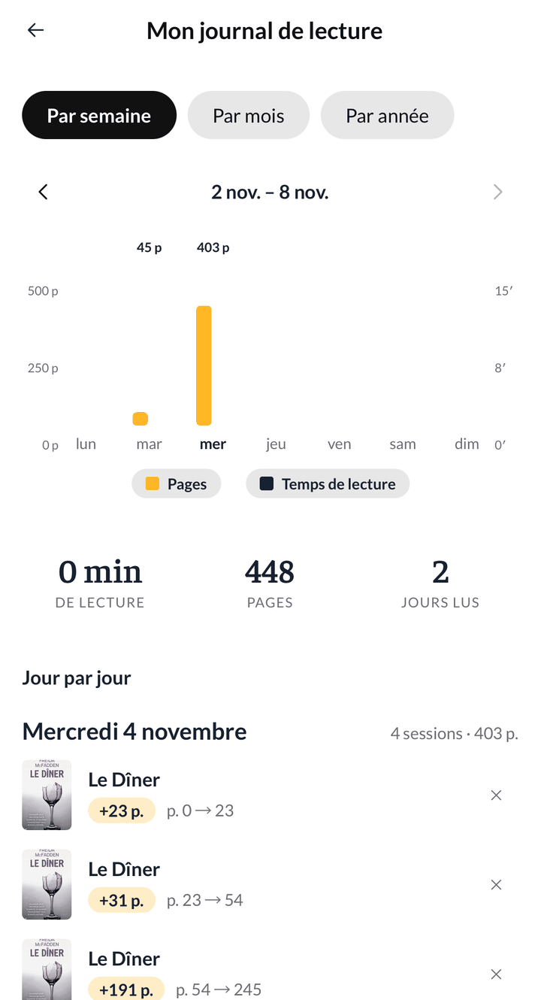
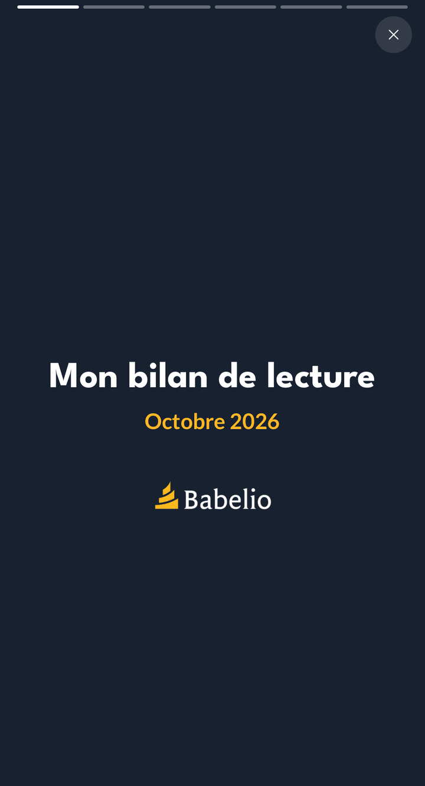

## Nouveautés

### Le tirage au sort fait tourner vos livres

Vous hésitez entre plusieurs livres de votre pile ? Le tirage au sort fait
maintenant tourner vos couvertures sur une roue en 3D, en plein écran : elle
prend de la vitesse, ralentit longuement, puis s'arrête sur le livre choisi,
seul au centre. Les couvertures sont chargées avant le départ, la roue ne
tourne plus jamais à vide.

### Votre journal, séance par séance

La liste « Jour par jour » de votre journal montre maintenant toutes les
séances de chaque jour, du plus récent au plus ancien : le livre, les pages
lues et l'endroit où vous en étiez, sans rien avoir à déplier. Les jours sans
lecture n'y figurent plus.

### Le bilan du mois se feuillette d'un geste

Des repères en haut de l'écran indiquent combien de pages compte votre bilan
et où vous en êtes. À l'ouverture, la couverture s'écarte un instant pour
montrer la suite, et un simple toucher fait passer à la page suivante.

### Des dates de lecture pour tous vos livres

Vous pouvez saisir une date de début et de fin de lecture pour n'importe quel
livre, même s'il est encore « À lire » ou dans vos envies.

## Corrections

- **Vos avancées en pourcentage comptent dans votre journal.** Une avancée
  notée en %, ou un livre terminé avec « J'ai fini ce livre », n'ajoutait
  aucune page à votre journal, alors que l'historique du livre les comptait.
  Les deux affichent maintenant le même nombre de pages.
- **« J'ai fini ce livre » demande à quelle page la séance a commencé**,
  comme le reste de la fenêtre qui raisonne en pages atteintes. Laissez le
  champ vide si vous ne savez plus.
- **Terminer un livre n'ajoute plus de ligne « +0 page »** à son historique,
  depuis la fenêtre de modification comme depuis l'accueil.
- **Le pourcentage d'une séance s'affiche correctement** dans le journal :
  « 100 % » et non plus « 1% ».
