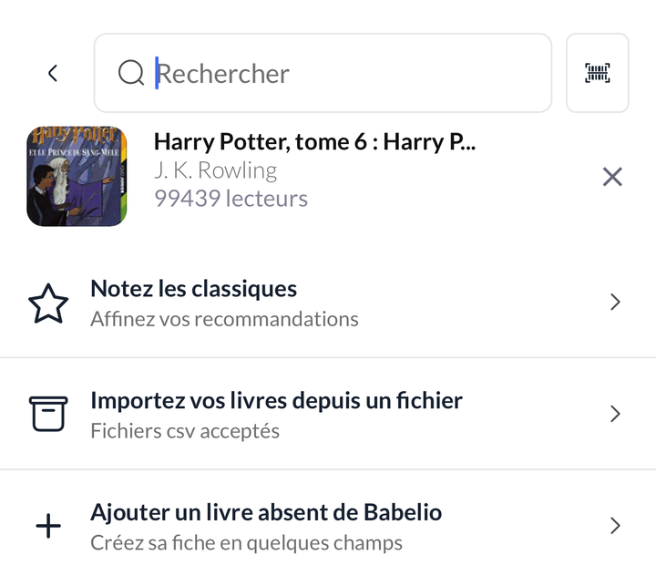
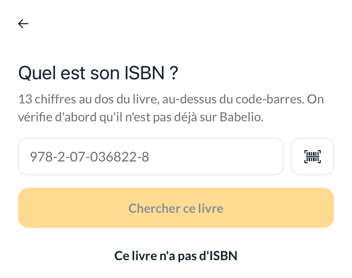
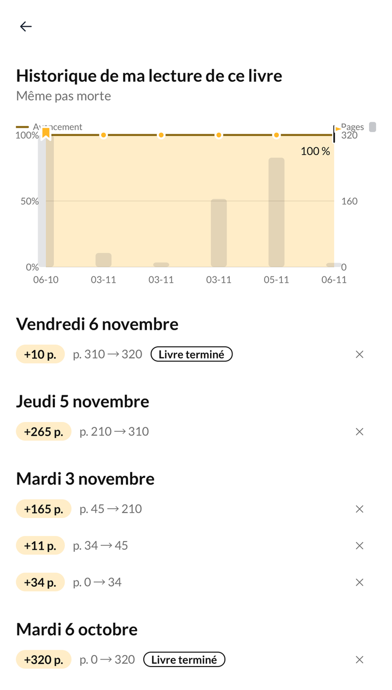

## Nouveautés

### Ajoutez un livre absent de Babelio

Un livre introuvable, même après la recherche chez Amazon ? Créez sa fiche
sans quitter l'appli, depuis « Ajouter un livre absent de Babelio » dans la
recherche, ou quand un code-barres scanné ne donne rien.

Commencez par son ISBN, tapé ou scanné : s'il existe déjà, sur Babelio ou
ailleurs, l'appli vous le montre pour l'ajouter directement. Sinon, son titre
et son auteur servent à une dernière vérification, puis vous décrivez le
livre : couverture en photo, auteurs et traducteurs, éditeur, date de
parution, nombre de pages, format et résumé. Le livre rejoint aussitôt vos
étagères.

### L'historique d'un livre se lit comme votre journal

L'historique de lecture d'un livre regroupe maintenant vos séances jour par
jour : pour chacune, les pages lues, la page de départ et la page atteinte,
le temps de lecture et, le cas échéant, « Livre terminé ». Le même format que
le journal, d'un écran à l'autre.

### Finir un livre, de la page où vous en étiez

« J'ai fini ce livre » affiche maintenant « Lu aujourd'hui de la page 210 à
320 » : la page de votre dernière avancée et le nombre de pages du livre,
que vous pouvez corriger l'un et l'autre avant de valider.

### Votre défi annuel, au rythme des jours

« Plus que 13 livres (ou 13 par mois) » restait le même du 1er au 30 du
mois. Le défi indique désormais le rythme à tenir jusqu'au 31 décembre :
« 1 livre tous les 4 jours », puis « 2 par jour » si la fin d'année se
resserre. Le chiffre se met à jour chaque jour.

## Corrections

- **Vos dates de lecture ne bougent plus toutes seules.** Saisir une avancée
  depuis l'accueil remplaçait la date de début par celle du jour, et un livre
  déjà lu repassé en « Lu » voyait sa date de fin déplacée. Les dates déjà
  saisies sont maintenant conservées.
- **Modifier une date ne crée plus de relecture.** Corriger la date de début
  d'un livre lu une seule fois ajoutait une seconde lecture. Une relecture ne
  s'ouvre plus qu'avec le bouton « + ».
- **Une relecture s'affiche sur la fiche du livre.** La fiche montrait la
  première lecture et son avancement, même pendant une relecture. Elle
  affiche maintenant la lecture en cours et ses seules séances.
- **Une première avancée en pourcentage compte ses pages.** Notée depuis
  l'accueil, le journal ou le chronomètre, elle n'apparaissait dans le journal
  qu'avec « p. 0 → 122 » et aucune page lue. Elle est maintenant enregistrée
  en pages.
- **Une nouvelle lecture repart de la page 0** dans le journal et
  l'historique, au lieu d'afficher « p. 320 → 34 ».
- **Les statistiques par thème s'ouvrent à nouveau** pour les lecteurs qui ont
  encore peu de livres datés.
- **Les dates de lecture s'affichent en clair**, « 7 oct. 2024 » au lieu de
  « 2024-10-07 ».
- **Le nombre de pages lues du bilan mensuel est lisible**, en blanc sur le
  fond sombre.
- **« J'ai lu aujourd'hui » tient sur une ligne** sur l'accueil, même avec un
  thème à police serif.
- Dans l'appli en espagnol, les jours sous le graphique du journal sont
  traduits.
