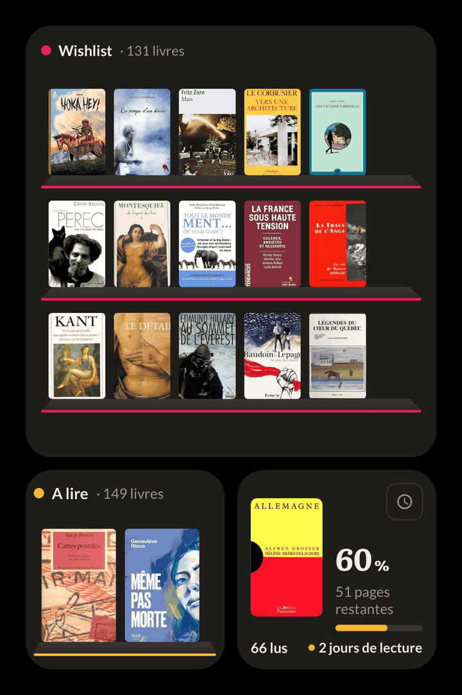

## Nouveautés

### Des widgets tout neufs, sur iPhone et Android

Le widget « Lecture en cours » a été entièrement redessiné, en trois tailles.
En petit, la couverture de votre livre, le pourcentage lu et les pages qui
restent ; en moyen, le titre et la progression ; en grand, votre livre du
moment puis les autres livres en cours. Votre série de jours de lecture et
votre défi annuel (« 66 lus sur 80 ») s'y affichent aussi, et le widget suit
le mode sombre de votre téléphone.

Un second widget, « Étagère », pose les couvertures de l'étagère de votre
choix sur un rayonnage, comme dans Mes livres : En cours, À lire, Wishlist,
Lu, ou l'une de vos étagères personnelles. Pour la choisir, faites un appui
long sur le widget puis « Modifier le widget » (iPhone, iOS 17 ou plus
récent), ou « Reconfigurer » (Android).

### Lancez le chronomètre depuis le widget

Le bouton horloge du widget « Lecture en cours » ouvre directement le
chronomètre du livre affiché : un appui, et vous êtes prêt à lire.

## Corrections

- **La version de l'appli s'affiche correctement** dans les réglages, avec
  son numéro de build.
