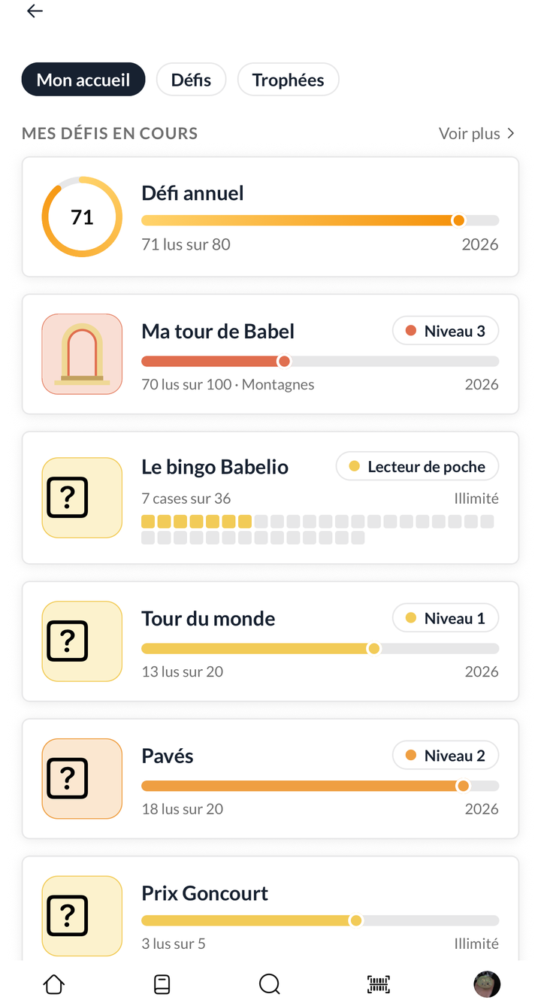

## Nouveautés

### Des défis libres et un bingo de lecture

De nouveaux défis à rejoindre depuis l'écran Défis. Dans un défi libre, vous
choisissez vous-même les livres qui comptent. Dans un bingo, chaque livre
terminé coche une case de la grille. Vous montez de niveau au fil des livres,
et vous pouvez partager votre avancée en image. Quand vous finissez un livre,
l'appli vous propose de l'ajouter à vos défis en cours.

### Des widgets à votre goût

Choisissez le fond de vos widgets, transparent compris sur Android. Sur
iPhone, ils s'installent aussi sur l'écran verrouillé, et le format vertical
d'Android a été repensé.

### Ajouter une série avec le bon statut

Sur la page d'une série, choisissez Lu, En cours, À lire ou Wishlist avant
d'ajouter la série entière ou un seul de ses livres.

## Corrections

- **Changer la date de fin d'un livre déplace aussi sa lecture** dans le
  journal, au lieu de la laisser au jour où vous l'avez marqué comme lu.
- **La première séance d'un livre compte ses pages**, même quand aucune
  séance n'avait été notée avant.
- **Le défi annuel n'a plus qu'un seul compteur** sur le profil.
- **Les écrans Défis et Trophées n'affichent que ce qui reste à obtenir** ;
  vos défis en cours et vos trophées sont dans « Mon accueil ».
